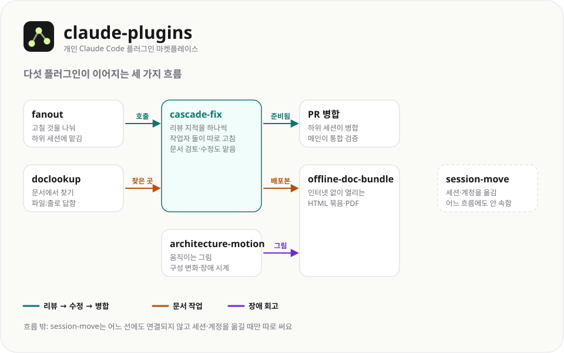

# claude-plugins

<p align="center">
  <picture>
    <source media="(prefers-color-scheme: dark)" srcset="docs/readme/overview-dark.svg">
    
  </picture>
</p>

sch0718이 만든 Claude Code 플러그인 여섯 개를 한곳에 모은 마켓플레이스예요. 아래에서 무엇이 있는지, 어떤 상황에 쓰는지 보고 필요한 것만 설치하면 돼요.

## 설치

```
/plugin marketplace add sch0718/claude-plugins
```

플러그인은 하나씩 골라 설치해요. 설치 명령은 아래 표와 각 소개에 있어요.

## 한눈에 보기

| 플러그인 | 한 줄 소개 | 이럴 때 써요 | 설치 |
|---|---|---|---|
| [cascade-fix](plugins/cascade-fix) | 리뷰 지적을 작업자 둘이 따로 고치고, 갈린 것만 Opus가 판가름 | 「리뷰하고 고쳐줘」, 「PR 코멘트 반영해줘」, 「설계 문서 검토하고 고쳐줘」 | `/plugin install cascade-fix@sch0718-plugins` |
| [fanout](plugins/fanout) | 고칠 것들을 하위 세션에 나눠 맡기고 PR 병합·정리까지 | 진단 뒤 고칠 것이 여럿 쌓였을 때 (`/fanout`) | `/plugin install fanout@sch0718-plugins` |
| [doclookup](plugins/doclookup) | 문서를 절 단위로 색인해 쓰인 곳을 `파일:줄`로 찾음 | 큰 문서 묶음에서 용어·ID가 쓰인 곳, 바꾸면 같이 고칠 곳이 궁금할 때 | `/plugin install doclookup@sch0718-plugins` |
| [session-move](plugins/session-move) | Code 탭 세션을 다른 계정·다른 기기로 옮김 | 사용량 한도로 계정을 바꿀 때, 새 기기로 이사할 때 | `/plugin install session-move@sch0718-plugins` |
| [offline-doc-bundle](plugins/offline-doc-bundle) | 마크다운을 인터넷 없이 열리는 HTML·PDF 묶음으로 | 회의 자료를 메일로 보내거나 폐쇄망에 반입할 때 | `/plugin install offline-doc-bundle@sch0718-plugins` |
| [architecture-motion](plugins/architecture-motion) | 구성 변화·요청 흐름·장애 전파를 움직이는 그림으로 | 재구성 전후 설명, 장애 회고 발표 | `/plugin install architecture-motion@sch0718-plugins` |
| [story-video](plugins/story-video) | 이야기를 기승전결 대본·장면 그림·음성·자막의 5~10분 영상으로 | 창작 이야기, 커뮤니티의 유명한 이야기를 영상으로 만들 때 | `/plugin install story-video@sch0718-plugins` |

## 상황별로 고르기

| 이런 일이 있어요 | 이걸 써요 |
|---|---|
| 코드 리뷰나 PR 코멘트로 지적이 여럿 나왔어요 | cascade-fix |
| 구현 전에 설계·계획 문서 초안을 검토하고 싶어요 | cascade-fix |
| 진단해 보니 고칠 것이 열 개쯤 쌓였고 동시에 처리하고 싶어요 | fanout (안에서 cascade-fix를 써요) |
| 수백 쪽 문서 중에서 「이 용어가 어디에 나오지?」를 알고 싶어요 | doclookup |
| 요구사항 ID를 바꾸려는데 같이 고칠 곳을 빠뜨릴까 걱정돼요 | doclookup |
| 사용량 한도에 걸려 다른 계정으로 이어서 작업하고 싶어요 | session-move |
| 새 맥으로 옮기면서 세션·설정·메모리를 가져가고 싶어요 | session-move |
| 마크다운 문서를 폐쇄망에서 그대로 열리게 보내야 해요 | offline-doc-bundle |
| 서버 이전·이중화·장애 회고를 움직이는 그림으로 설명해야 해요 | architecture-motion |
| 이야기 하나를 자막·음성이 들어간 짧은 영상으로 만들고 싶어요 | story-video |

## 플러그인 소개

### cascade-fix

리뷰에서 나온 지적을 Claude Code가 **지적 하나씩** 고치게 해요. 지적마다 작업자 둘(Sonnet, Haiku)이 서로 다른 워크트리에서 따로 고치고, 스크립트가 테스트를 다시 돌려 둘이 맞으면 채택해요. 비싼 Opus는 둘이 갈린 지적에만 붙고, 그래도 못 정한 것은 사람이 고를 목록으로 넘겨요. 커밋·push·resolve·답글은 하지 않고 「준비됨」 상태로 멈춰요.

- **할 수 있는 일:** 변경·브랜치·커밋 리뷰 후 수정, PR 리뷰 스레드 반영(답글 초안 포함), 설계·계획 문서 검토와 수정, Codex·Cursor 리뷰 결과 파일 처리, 역할 프로필로 검토자·작업자를 Claude·Codex·Cursor에 나눠 맡기기, 사용량 기록과 표
- **이렇게 말해요:** 「이번 변경 리뷰하고 고쳐줘」, 「PR 코멘트 반영해줘」, 「스펙 초안 검토하고 고쳐줘」, 「cascade-fix 설정해줘」
- **쓰지 않는 경우:** 리뷰만 원하고 고치지 말라는 요청, 문서를 처음부터 새로 쓰는 일, 여러 파일 리팩터링, 테스트 없는 저장소의 코드 수정, 한두 줄짜리 수정
- **필요한 것:** Claude Code(Workflow 도구), Python 3.11 이상, git. PR 코멘트는 로그인된 `gh`가 필요해요.
- 자세히: [plugins/cascade-fix](plugins/cascade-fix)

### fanout

대화에서 정리한 「고칠 것들」을 서로 같은 파일을 건드리지 않게 묶어 하위 세션으로 띄워요. 각 하위 세션은 설계·계획 검토, Codex 구현, Opus 검토, cascade-fix 수정을 거쳐 PR 병합까지 혼자 끝내요. 모두 끝나면 메인 세션이 합쳐진 상태를 다시 검증하고 세션·워크트리·브랜치를 정리해요.

- **할 수 있는 일:** 항목 묶기와 2단계 나누기, 띄우기 전 사용량 확인(80% 넘으면 기다릴지 묻기), 병합 확인, 통합 검증, 정리, 최종 보고
- **이렇게 말해요:** `/fanout:fanout`, `/fanout:fanout 3번 빼고`, `/fanout:fanout 병합은 하지 말고 PR까지만`, 「나눠서 병렬로 진행하고 병합까지」
- **쓰지 않는 경우:** 한두 줄짜리 수정 하나뿐일 때는 메인 세션에서 바로 고쳐요. 직접 병합을 금지한 저장소에서는 PR까지만 만들어요.
- **필요한 것:** Claude 데스크톱 앱의 Code 탭(터미널 `claude`에서는 동작하지 않아요), cascade-fix, superpowers 플러그인, Codex CLI, `gh`
- 자세히: [plugins/fanout](plugins/fanout)

### doclookup

저장소 문서를 제목 단위 절로 색인해 두고, 용어·ID·링크가 쓰인 곳과 「바꾸면 같이 고칠 곳」을 `파일:줄`로 돌려줘요. 큰 문서를 통째로 Read하거나 grep 결과를 손으로 모으는 대신 이걸 먼저 써요.

- **할 수 있는 일:** `search`(낱말과 표기 묶음이 쓰인 곳), `section`(절 읽기), `impact`(바꾸면 같이 고칠 곳), `refs`·`links`(가리키는 곳과 깨진 링크), 큰 파일을 통째로 읽으려 할 때 조회 명령을 안내하는 Read 훅(기본 꺼짐)
- **특징:** 저장소별 설정은 기기의 설정 폴더에 두므로 작업 저장소에 아무것도 만들지 않아요. Python 3.11 이상 표준 라이브러리만 쓰고 네트워크 호출이 없어요.
- **이렇게 말해요:** 「이 용어가 어디에 쓰였는지 찾아줘」, 「이 ID를 바꾸면 어디를 같이 고쳐야 해?」
- 자세히: [plugins/doclookup](plugins/doclookup)

### session-move

Claude 데스크톱 앱 Code 탭의 세션을 같은 기기의 다른 계정으로, 또는 번들로 묶어 다른 기기로 옮겨요.

- **같은 기기(계정 전환):** 세션, 하위 세션 연결, 워크트리·브랜치 정보, 예약 작업, backlog를 옮기고, 그룹·섹션·핀은 새 계정에서 다시 만들어요. 대화 기록·`CLAUDE.md`·메모리는 같은 기기라 옮길 필요가 없어요.
- **다른 기기:** `sessions.tar.gz` 번들에 세션·대화 기록·설정·스킬·플러그인 목록·MCP 서버 정의·메모리·저장소 주소를 담아요. 항목은 `--only`·`--skip`으로 고르고, 대상에 이미 있는 설정은 덮어쓰지 않고 옆에 둬요.
- **이렇게 말해요:** 「다른 계정 세션 가져와」, 「사용량 한도 때문에 다른 계정으로 옮겨」, 「다른 기기로 세션 옮겨」
- **필요한 것:** macOS, Python 3.11 이상. 적용할 때는 앱을 끄고 터미널 앱에서 해요.
- 자세히: [plugins/session-move](plugins/session-move)

### offline-doc-bundle

마크다운 문서를 인터넷이 없는 환경에서도 그대로 열리는 배포본(HTML 묶음, 목차, 발표용 PDF)으로 만들어요. 변환 뒤에 깨지기 쉬운 부분을 정리하고 검증해요.

- **할 수 있는 일:** Mermaid 다이어그램을 SVG로 굳혀 HTML에 넣기, 문서 간 링크의 `.md`를 `.html`로 바꾸기, 모든 문서에 `← 목차` 바 붙이기, 배포하면 안 되는 문서 지우고 그 링크는 「미배포」로 낮추기, 목차 페이지·검증·압축
- **이렇게 말해요:** 「회의 자료 만들어줘」, 「폐쇄망에서 열리게」, 「메일로 보낼 문서로 변환해줘」
- **알아둘 점:** 마크다운→HTML·PDF 변환기 자체는 들어 있지 않아요. 프로젝트의 변환 스크립트와 Marp·Mermaid CLI가 필요하고, 이 플러그인은 그 결과를 정리·검증해요.
- 자세히: [plugins/offline-doc-bundle](plugins/offline-doc-bundle)

### architecture-motion

시스템 구성이 어떻게 바뀌었는지, 그 안에서 요청이 어떻게 흐르는지, 장애가 나면 무엇이 달라지는지를 브라우저에서 재생되는 모션 그래픽으로 만들어요. 결과물은 외부 CDN 없는 정적 HTML 묶음이라 폐쇄망에서도 열려요.

- **할 수 있는 일:** 구성 변화(이전 → 장애 → 전환 → 이후), 장애 시계(경과 기록 → 되감기 → 바뀐 구성이었다면), 관점 토글, 재생 막대·자막·말풍선, 글자 넘침·말풍선 겹침을 잡는 점검 스크립트
- **이렇게 말해요:** 「재구성 전후를 움직이는 그림으로 보여 줘」, 「장애가 어떻게 번졌는지 모션 그래픽으로 만들어 줘」, 「포스트모템 발표용 애니메이션」
- **알아둘 점:** MP4·GIF 변환은 하지 않아요. 영상이 필요하면 브라우저에서 재생하며 화면을 녹화해 주세요.
- 자세히: [plugins/architecture-motion](plugins/architecture-motion)

## 함께 쓰는 조합

- **리뷰 → 수정 → 병합:** cascade-fix가 지적 하나하나를 고치고, 고칠 것이 여럿이면 fanout이 세션으로 나눠 병렬로 돌려요. fanout의 각 세션이 cascade-fix를 불러 써요.
- **문서 작업:** doclookup으로 바꿀 곳을 찾고, cascade-fix로 문서를 검토·수정하고, offline-doc-bundle로 배포본을 만들어요.
- **장애 회고 발표:** architecture-motion으로 움직이는 그림을 만들고, offline-doc-bundle로 회고 문서와 함께 묶어요.

### 움직이는 그림으로 보기

위 세 조합이 어떻게 이어지는지는 [`docs/motion`](docs/motion)에 모션 그래픽으로 만들어 뒀어요. 외부 CDN 없는 정적 HTML이에요. 첫 장면은 「고칠 것이 쌓였다 → fanout이 나눈다 → 하위 세션마다 cascade-fix로 고친다 → PR 병합 → 통합 검증」이고, 문서 작업과 장애 회고는 위쪽 관점 버튼으로 바꿔 볼 수 있어요.

GitHub README에서는 스크립트가 실행되지 않아요. `docs/motion` 폴더를 내려받아 아래처럼 열어 주세요.

```
cd docs/motion
python3 -m http.server 8000
```

그다음 브라우저에서 `http://localhost:8000/`을 열어요. `index.html`을 브라우저로 바로 열어도 되지만 스크립트가 붙지 않는 경우가 있어서 서버를 권해요. 주소 끝에 `?view=` 값을 붙이면 처음 볼 관점을 고를 수 있어요.

| `?view=` | 관점 |
|---|---|
| `fanout` | 리뷰 → 수정 → 병합 (기본) |
| `docs` | 문서 작업 |
| `incident` | 장애 회고 |

## 저장소 규칙

- 회사·팀·동료 이름, 회사 저장소 이름, 사내 주소는 파일·경로·커밋 메시지·브랜치 어디에도 넣지 않아요. 커밋과 push 때 `tools/scan-private`가 검사해요(아래 「처음 받았을 때」).
- 각 플러그인의 시험은 플러그인 폴더의 README를 따라요. 저장소 공통 시험은 `python3 -m unittest discover -s tests`(Python 3.11 이상)예요.
- 라이선스는 플러그인마다 폴더 안 `LICENSE`(PolyForm Noncommercial 1.0.0)를 따라요.

## 처음 받았을 때

```
git config core.hooksPath .githooks
```

훅은 저장소 밖 `~/.config/claude-plugins/denylist.txt`의 금지어 목록을 써요. 목록이 없으면 커밋이 막혀요. 한 줄에 하나씩 적고, 정규식은 `re:`로 시작해요.
