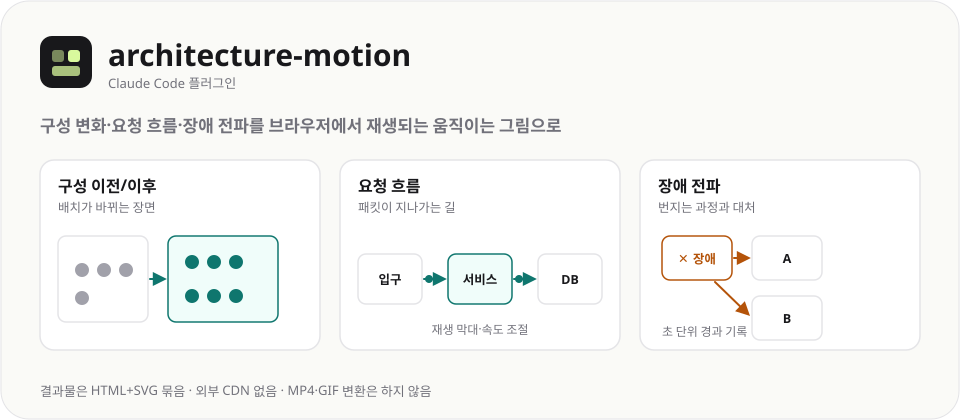

# architecture-motion

<p align="center">
  <picture>
    <source media="(prefers-color-scheme: dark)" srcset="docs/readme/hero-dark.svg">
    
  </picture>
</p>

시스템 구성이 어떻게 바뀌었는지, 그 안에서 요청이 어떻게 흐르는지, 장애가 나면 무엇이 달라지는지를 브라우저에서 재생되는 모션 그래픽으로 만들어 주는 개인용 Claude Code 플러그인이에요. 클러스터 재구성, 서버 이전, 이중화, 배치 규칙 변경, 장애 회고처럼 시간에 따라 움직이는 그림이 필요한 설명에 써요.

- 결과물은 정적 HTML 묶음(`index.html`, `motion.js`, `motion.css`, `diagram.js`, `scenes.js`)이에요. 외부 CDN이 없어서 폐쇄망에서도 열려요.
- 엔진이 타임라인, 패킷 흐름, 말풍선, 자막, 재생 막대, 관점 전환을 이미 갖고 있어요. 작업은 배치(`diagram.js`)와 장면(`scenes.js`)만 쓰면 돼요.
- MP4·GIF 변환은 하지 않아요. 영상이 필요하면 브라우저에서 재생하면서 화면을 녹화해 주세요.

## 설치

필요한 것: Claude Code. 점검 스크립트를 쓰려면 Node.js와 이 PC의 Chrome(또는 Chromium)도 필요해요.

Claude Code에서:

```
/plugin marketplace add sch0718/claude-plugins
/plugin install architecture-motion@sch0718-plugins
```

## 사용

"재구성 전후를 움직이는 그림으로 보여 줘", "장애가 어떻게 번졌는지 모션 그래픽으로 만들어 줘"처럼 요청하면 스킬 `architecture-motion`이 이어받아요. 보통 이런 순서로 진행해요.

1. 설계 문서, 장애 보고서, 로그에서 구성·수치·시각을 모으고 장면마다 출처를 메모해요. 추정은 "(추정)"으로 표시하고, 바뀐 구성이 막지 못하는 것은 한계로 따로 밝혀요.
2. 보는 사람(IT팀, 경영진, 감사 담당)과 방향을 정해요. 방향은 「구성 변화」(이전 → 장애 → 전환 → 이후)와 「장애 시계」(경과 기록 → 되감기 → 바뀐 구성이었다면)가 있고, 관점 토글로 함께 묶을 수 있어요.
3. 템플릿(`assets/`)을 복사해서 `diagram.js`로 구역·칩·레이아웃을, `scenes.js`로 관점별 장면(흐름, 말풍선, 자막, 멈춤)을 써요.
4. 점검 스크립트로 글자 넘침, 말풍선 겹침 같은 문제를 0으로 만든 뒤 보여 줘요.

완성된 예시는 `skills/architecture-motion/examples/sample-cluster/`예요(가상 웹 서비스의 노드 재배치, 관점 2개). 폴더째 브라우저로 열 수 있고, 파일을 직접 여는 대신 정적 서버로 띄우는 편이 안전해요.

```bash
python3 -m http.server 8000 --directory skills/architecture-motion/examples/sample-cluster
```

뷰어 주소에 `?view=<관점 키>`, `?t=<이야기 초>`, `?speed=1.5`, `?play=0`을 붙일 수 있어요. 엔진은 장면을 0.5배로 느리게 재생하고(`M.base`), 재생 막대의 속도(기본 1×, 0.5×~2×)와 `?speed`는 거기에 곱해져요.

### 점검 스크립트

`scripts/check.mjs`는 이 PC의 Chrome을 헤드리스로 띄워 관점마다 전 구간을 그려 보고 아래를 알려 줘요: 렌더·브라우저 오류, 말풍선·칩·상자의 글자 넘침, 말풍선끼리 겹침과 자막 가림, 반투명한 채 멈춤, 자막 없는 구간. 멈춤 구간마다 화면을 캡처해요.

```bash
(cd skills/architecture-motion/scripts && { [ -d node_modules ] || npm i --no-audit --no-fund; })
node skills/architecture-motion/scripts/check.mjs <프로젝트 폴더> --out <캡처 폴더>
```

- `--out`을 빼면 프로젝트 폴더 옆 `check-shots`에 저장해요. `--no-shots`는 캡처를 만들지 않아요.
- Chrome을 못 찾으면 환경 변수 `CHROME`에 실행 파일 경로를 주세요.
- 스크립트는 어색함까지는 못 잡아요. 캡처 몇 장은 직접 열어서 눈으로도 확인해 주세요.

### 게시

움직이는 HTML을 그대로 올릴 수 있는지는 곳마다 달라요. 브라우저(파일 공유, 사내 웹서버)는 되고, OpenProject는 스크립트를 걷어 내서 안 되고, XWiki는 스크립트 권한에 따라 달라요. 자세한 표는 `skills/architecture-motion/references/publishing.md`에 있어요.

## 개발

| 경로 | 맡는 일 |
|---|---|
| `.claude-plugin/plugin.json` | 플러그인 매니페스트(마켓플레이스는 저장소 루트 `.claude-plugin/marketplace.json`의 `sch0718-plugins`) |
| `skills/architecture-motion/SKILL.md` | 언제·어떻게 쓰는지, 작업 순서 |
| `skills/architecture-motion/assets/` | 시작용 템플릿과 엔진(`motion.js`, `motion.css`, `index.html`은 고치지 않아요) |
| `skills/architecture-motion/examples/sample-cluster/` | 완성 예시 |
| `skills/architecture-motion/references/` | 엔진 API, 시간 정하기, 게시 |
| `skills/architecture-motion/scripts/` | 점검 스크립트(`check.mjs`, `puppeteer-core`) |

## 라이선스

[PolyForm Noncommercial 1.0.0](LICENSE)으로, 비상업 목적으로만 쓸 수 있어요.
배포할 때는 `LICENSE`의 Required Notice 줄을 유지해 주세요.
OSI 오픈소스 라이선스는 아니에요.

- 개인 사용, 학습·연구, 비영리 단체·교육·공공 기관의 사용은 자유롭게 할 수 있어요. 고쳐 쓰는 것도 돼요.
- 상업적 목적의 사용은 할 수 없어요. 회사 업무에 쓰는 것도 여기에 들어가요. 상업적으로 쓰려면 따로 문의해 주세요.
- 복사본이나 고친 판을 다른 사람에게 줄 때는 라이선스 전문(또는 URL)과 아래 줄을 함께 넘겨 출처를 밝혀야 해요.

  ```
  Required Notice: Copyright (c) 2026 신춘호 (sch0718) (https://github.com/sch0718/claude-plugins/tree/main/plugins/architecture-motion)
  ```
