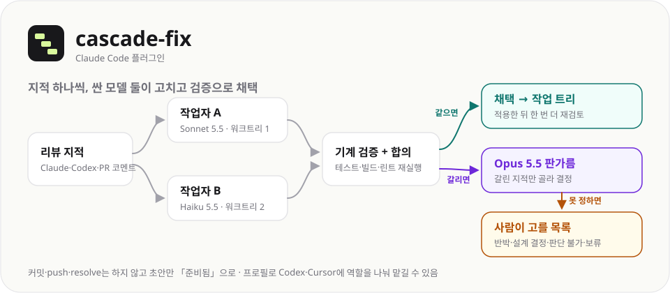
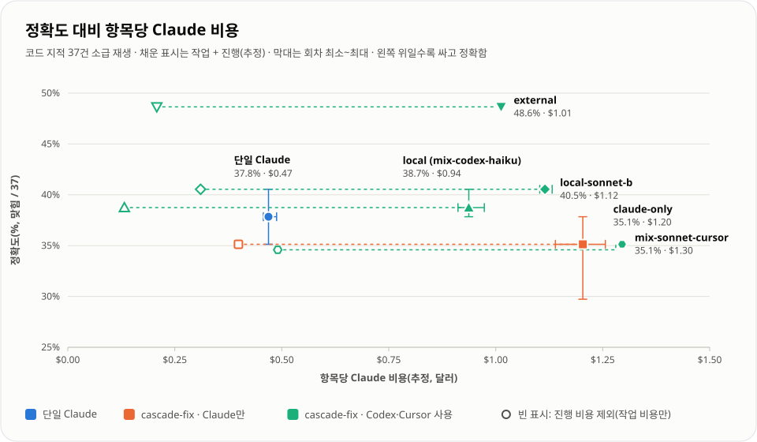

# cascade-fix

<p align="center">
  <picture>
    <source media="(prefers-color-scheme: dark)" srcset="docs/readme/hero-dark.svg">
    
  </picture>
</p>

<p align="center"><b>리뷰 지적을 싼 모델 둘이 고치고, 갈린 것만 Opus가 판가름하는 Claude Code 플러그인</b><br>
Claude Code에 「리뷰하고 고쳐줘」라고 말하면 끝까지 진행합니다</p>

코드 리뷰나 PR 코멘트에서 나온 지적을 Claude Code가 **지적 하나씩** 고치게 합니다. 지적마다 작업자 둘이 서로 다른 워크트리에서 따로 고치고, 스크립트가 테스트를 다시 돌려 둘이 맞으면 채택합니다. 비싼 Opus는 둘이 갈린 지적에만 붙고, 그래도 못 정한 것은 사람이 고를 목록으로 넘깁니다. 커밋·push는 하지 않고 초안만 준비해 둡니다.

## 이런 걸 할 수 있어요

|                        |                                                                                                                      |
| ---------------------- | -------------------------------------------------------------------------------------------------------------------- |
| 🔍 **리뷰하고 고치기** | 커밋하지 않은 변경, 브랜치, 특정 커밋을 Claude가 먼저 검토하고 나온 지적을 바로 고칩니다. Codex가 없어도 됩니다.     |
| 💬 **PR 코멘트 반영**  | 해결 안 된 PR 리뷰 스레드를 지적으로 읽고 고칩니다. 스레드마다 답글 초안과 resolve 대상도 만들어 둡니다.             |
| 📝 **설계 문서 검토**  | 스펙·계획서 초안을 구현 전에 검토하고 고칩니다. 사람이 정해야 할 것은 선택지와 장단점을 붙여 따로 모읍니다.          |
| 📥 **리뷰 결과 받기**  | Codex·Cursor 리뷰 결과 파일(`*.final`)을 넘기면 그 지적을 고칩니다.                                                  |
| ⚖️ **합의로 채택**     | 작업자 둘의 판정과 등록한 검증(테스트·빌드·린트) 결과로 채택합니다. 코드 모드에서 보안·인증·삭제 경로를 건드리거나 기존 테스트를 지우거나 고친 수정은 채택하지 않고 사람에게 넘깁니다. |
| 🔀 **역할 나눠 맡기기** | 프로필로 검토자·작업자를 Claude·Codex·Cursor에 나눠 맡겨 Claude 사용량을 줄입니다.                                   |
| 📊 **사용량 보기**      | 켜 두면 모델·역할·제공자별 호출 수, 토큰, 추정 비용을 기록하고 표로 보여 줍니다. 기본값은 꺼짐입니다.                  |

## 어떻게 동작하나요

코드 모드의 흐름입니다. 문서 모드는 작업자 둘 대신 판정자 둘과 작성자 하나(필요하면 점검자)가 붙습니다.

```
리뷰 지적 ─┬─ 작업자 A (Sonnet) ─┐
           └─ 작업자 B (Haiku)  ─┴─ 기계 검증 + 합의 ─┬─ 채택 → 작업 트리에 적용 → 재검토
                                                    └─ 갈림 → Opus 판가름 ─┬─ 채택
                                                                          └─ 판단 불가 → 검토자 의견 + 사람 목록
```

1. **판정** — 저장소를 읽기만 하고 무엇을 처리할지(변경·PR·문서·결과 파일) 고릅니다.
2. **계획 확인 한 번** — 처리할 대상, 맡을 모델, 예상 에이전트 수를 보여 주고 「진행 / Critical·Warning만 / dry-run」 중 하나를 고르게 합니다.
3. **끝까지 진행** — 검토 → 작업자 둘 → 검증 → 판가름 → 적용 → 재검토를 단계마다 묻지 않고 이어 갑니다. 재검토에서 Critical이 나오거나 고칠 지적이 여럿 남으면 회차를 한 번 더 엽니다(재검토는 최대 2회).
4. **보고** — 사람이 고를 것만 네 칸(반박·설계 결정·판단 불가·보류 후보)으로 모아 묻습니다.

## 설치

필요한 것: **Claude Code**(Workflow 도구 사용 가능), **Python 3.11+**(외부 패키지 없음), **git**. PR 코멘트를 처리하려면 로그인된 `gh` CLI도 필요합니다.

Claude Code 세션에서:

```
/plugin marketplace add sch0718/claude-plugins
/plugin install cascade-fix@sch0718-plugins
```

터미널에서는 `claude plugin marketplace add sch0718/claude-plugins` 뒤 `claude plugin install cascade-fix@sch0718-plugins`입니다. 새 버전은 다음 세션부터(또는 `/reload-plugins` 뒤) 적용되며, 업데이트는 이렇게 합니다.

```bash
claude plugin marketplace update sch0718-plugins
```

```bash
claude plugin update cascade-fix@sch0718-plugins
```

<details>
<summary>플러그인 대신 개인 스킬로 설치하기</summary>

둘 중 하나만 설치합니다. 둘 다 설치하면 같은 이름의 스킬이 겹칩니다.

```bash
git clone https://github.com/sch0718/claude-plugins.git ~/src/claude-plugins
```

```bash
ln -s ~/src/claude-plugins/plugins/cascade-fix ~/.claude/skills/cascade-fix
```

업데이트는 `git -C ~/src/claude-plugins pull`로 합니다.

v1.6.6에서 저장소 이력을 새로 만들었으므로, 그 전에 clone한 폴더는 `pull`이 되지 않습니다. 지우고 다시 clone합니다.
</details>

## 시작하기

1. **이 기기 설정(선택)** — Claude Code에 「cascade-fix 설정해줘」라고 말합니다. 설치된 Codex·Cursor와 로그인 여부를 보고 맞는 프로필을 추천하고, 고른 값을 `~/.claude/cascade-fix/repos.toml`에 적습니다. 건너뛰면 Claude 작업자로 돕니다.
2. **고칠 저장소에서 말하기** — 「이번 변경 리뷰하고 고쳐줘」라고 말합니다.
3. **처음 한 번 테스트 명령 확인** — 코드를 고치려면 저장소의 테스트 명령이 필요합니다. `package.json`·`pyproject.toml`·`Makefile`을 보고 후보를 찾아 보여 주니 확인만 하면 됩니다.
4. **계획 확인 → 보고** — 계획을 한 번 확인하면 끝까지 진행하고, 사람이 고를 것만 묻습니다.

## 사용 예시

말로 맡기면 됩니다. 플러그인이면 `/cascade-fix:cascade-fix`, 개인 스킬이면 `/cascade-fix`로 직접 부를 수도 있습니다.

### 작업한 변경을 리뷰하고 고치기

```
이번 변경 리뷰하고 고쳐줘
main 대비 이 브랜치 리뷰하고 지적 반영해줘
```

커밋하지 않은 변경이나 기준 브랜치보다 앞선 커밋을 찾아 Claude가 먼저 검토하고, 나온 지적을 작업자 둘이 고칩니다. 실행 전에는 이런 계획을 한 번 보여 줍니다.

```
프로필: claude-only (repos.toml:default_profile)
역할: 첫 검토=Claude(Fable 5.2 high), A=Claude(Sonnet 5.5 low), B=Claude(Haiku 5.5 low), 판가름=Claude(Opus 5.5 high), 의견=Claude(Fable 5.2 high), 재검토=Claude(Fable 5.2 high)
→ 진행 / Critical·Warning만 / dry-run
```

### PR 리뷰 코멘트 반영하기

```
PR 코멘트 반영해줘
42번 PR 리뷰 스레드 해소해줘
```

해결 안 된 리뷰 스레드를 고치고, 스레드마다 답글 초안(`prepared/replies.json`)과 resolve 대상(`prepared/resolve.json`)을 만듭니다. 답글을 달고 resolve하는 것은 사람이 합니다.

### 설계·계획 문서 검토하기

```
docs/superpowers/specs/2026-10-24-viewer-design.md 검토하고 고쳐줘
계획서 리뷰 돌려서 반영해줘
```

문서 모드로 돌아 테스트 명령이 필요 없습니다. 구체적인 계획서는 자동 채택이 많고, 초기 스펙은 「정하지 않은 결정」 지적이 많아 **설계 결정** 칸으로 모입니다. 이 칸에는 선택지와 장단점이 붙고, 결정은 사람이 합니다. superpowers를 쓴다면 brainstorming·writing-plans가 문서를 쓰고 자체 검토를 마친 뒤에 붙이기 좋습니다.

### 다른 도구의 리뷰 결과 넘기기

```
Codex 검토 결과(review.final) 반영해줘
이 리뷰 결과 파일 처리해줘: cursor-review-20261024.final
```

### 지적이 많거나 먼저 보고 싶을 때

```
Critical이랑 Warning만 고쳐줘
dry-run으로 돌려줘. 작업 트리는 건드리지 마
묻지 말고 진행해
```

`Critical·Warning만`으로 돌리면 나머지 등급은 보류 후보로 남고, 보고 단계에서 「지금 반영」을 고르면 이어서 처리합니다(정리한 뒤에는 새로 실행합니다). dry-run은 임시 워크트리에만 적용합니다.

## 결과 보기

끝나면 대상 저장소의 `.cascade-fix/<run_id>/report.md`(git 제외)에 보고서가 남고, 사람이 고를 것만 이렇게 묻습니다.

| 칸            | 무엇이 오나요                                                     | 고를 것                              |
| ------------- | ----------------------------------------------------------------- | ------------------------------------ |
| **반박**      | 작업자 둘이 「지적이 틀렸다」고 합의한 것                         | 동의 / 그래도 고친다                 |
| **설계 결정** | 코드·문서로는 정답을 정할 수 없는 것. 판정자 근거와 선택지가 붙음 | 고를 선택지 / 직접 정함 / 보류       |
| **판단 불가** | Opus도 못 정한 것. 검토자 의견과 패치 경로가 붙음                 | 직접 판단                            |
| **보류 후보** | 고르지 않은 등급, 재검토의 Suggestion 등                          | 지금 반영 / 구현 때 테스트로 / 보류  |

채택한 패치는 작업 트리에 적용만 되고 커밋되지 않습니다. 적용 뒤 전체 테스트가 실패해도 패치는 남아 있으니, 보고서의 「간섭 의심」 절을 보고 되돌릴지 정합니다. 커밋 메시지 초안은 `prepared/commit-message.txt`에 있습니다. 보고서에는 회차별 채택 경로와 역할별 호출 수·Claude 토큰·추정 비용도 남습니다.

## 사용량 보기

어떤 모델이 어떤 작업에서 비싸게 쓰였는지, 역할별로 의도한 모델·제공자가 쓰였는지 보고 싶을 때 켭니다. 기본값은 꺼짐입니다.

```
CF profile on        # 켜기. repos.toml에 profiling = true를 씁니다
CF profile status    # 지금 켜졌는지, 기록이 얼마나 쌓였는지
CF profile report    # 역할×모델 표: 호출 수, 토큰, 추정 비용, 대체 실행
CF profile off       # 끄기
```

- 켜 두면 실행이 끝날 때마다 사용량을 `~/.claude/cascade-fix/profile/`에 한 파일로 남깁니다. 지적 본문·코드·전체 경로는 담지 않고, 이 기기 밖으로 나가지 않습니다.
- `CF profile report --by model|runner|repo|week --since 2026-11-01`처럼 묶는 기준과 시작일을 바꿀 수 있습니다. `--json`을 붙이면 JSON으로 나옵니다.
- 이미 쓴 Claude 작업은 `CF profile import-sessions`로 로컬 세션 기록에서 가져와 합칩니다. Codex·Cursor는 원래 기록이 남지 않으므로 켠 뒤의 실행부터 집계됩니다.
- 단가표에 없는 모델의 비용은 「단가 모름」으로 나옵니다. 환경 변수 `CASCADE_PROFILING=1` 또는 `0`은 설정 파일보다 우선합니다.
- 옵션 전체는 [레퍼런스](docs/reference.md#프로파일링)에 있습니다.

## 활용 팁

- **Claude 사용량을 줄이고 싶다면** 프로필로 작업자 한쪽을 Codex에 맡깁니다. 「cascade-fix 설정해줘」로 고르거나 직접 적습니다.

  ```toml
  # ~/.claude/cascade-fix/repos.toml
  default_profile = "codex-sonnet"

  [profiles.codex-sonnet]
  base = "claude-only"
  "code.a" = { runner = "codex", effort = "medium" }
  "code.b" = { runner = "claude", model = "claude-sonnet-5-5", effort = "medium" }
  ```

  내장 프로필은 `default`(고르지 않았을 때), `claude-only`(외부 전송 없음), `local`(Codex 활용, 측정 전 잠정값) 셋입니다.
- **메인 세션 맥락을 줄이고 싶다면** Claude 작업을 `claude -p`로 돌리는 `--claude-via cli`를 쓸 수 있습니다. 기본은 Workflow이며, 계획 확인 때 「1단계 Claude 작업을 CLI(`claude -p`)로 돌린다」를 요청하면 이 옵션을 씁니다. 첫 검토는 이 옵션과 상관없이 Workflow로 실행합니다. 비용이 줄어드는지는 아직 확인하지 못했습니다([상세 레퍼런스](docs/reference.md#claude-작업을-claude--p로)).
- **코드를 밖으로 보내면 안 되는 저장소**는 첫 실행의 전송 동의 질문에서 「이 저장소는 항상 Claude만」을 고릅니다. Codex·Cursor를 쓰는 프로필이어도 그 저장소는 Claude로만 돕니다.
- **중간에 끊겨도** 상태가 원장(`ledger.json`)에 남아 있어 이어서 진행할 수 있습니다.
- **잘 맞지 않는 일**: 문서를 처음부터 쓰는 일, 여러 파일에 걸친 리팩터링, 테스트가 없는 저장소의 코드 수정, 한두 줄짜리 단순 수정.

## Claude 하나로 고치는 것과 비교하면

같은 리뷰 지적 37건(코드 모드, 정답 있음)을 Opus 5.5 하나로 직접 고치게 한 것(단일 Claude)과 cascade-fix 구성들을 견줬습니다. 비용은 작업 에이전트 몫에 메인 세션이 단계를 잇는 몫(실제 사용 기록에서 추정, 지적당 약 $0.80)을 더한 값입니다.

<p align="center">
  <picture>
    <source media="(prefers-color-scheme: dark)" srcset="docs/readme/cost-effectiveness-dark.svg">
    
  </picture>
</p>

| 구성 | 정확도 | 「아님」 오채택 | 항목당 Claude 비용 | 진행 비용 뺀 작업 비용 | 항목당 처리 시간 |
| --- | ---: | ---: | ---: | ---: | ---: |
| 단일 Claude (Opus 5.5) | 37.8% | 0 | **$0.47** (100%) | $0.47 (100%) | **1.2분** |
| `local` (Codex + Haiku) | 38.7% | 0 | $0.94 (200%) | **$0.13 (28%)** | 2.5분 |
| `local-sonnet-b` (Codex + Sonnet) | 40.5% | 0.3 | $1.12 (238%) | $0.31 (66%) | 2.1분 |
| `claude-only` (Sonnet + Haiku) | 35.1% | 0.7 | $1.20 (257%) | $0.40 (85%) | 2.0분 |

3회 평균, 판가름은 모두 Opus 5.5, 채택 규칙 켬. 이용 한도가 비용에 비례한다고 보면 괄호 안이 단일 Claude 대비 이용 한도입니다.

- **정확도는 같습니다.** 1~3건 차이는 흔들림 안이고, 정답이 「아님」인 지적을 사실로 채택한 일도 둘 다 거의 없습니다.
- **cascade-fix의 작업 비용은 싸지만, 지금은 메인 세션의 진행 비용이 그 이점을 넘습니다.** Claude 이용 한도를 아끼는 것만 보면 현재로선 Opus 하나로 직접 고치는 편이 싸고 빠릅니다.
- 이번에 값으로 재지 않은 cascade-fix의 장점은 패치 두 개 비교, 하네스의 검증 재실행, 보안 경로 차단, 사람 목록·보고서입니다. 표본 37건·소급 dry-run·진행 비용 추정 같은 한계와 민감도 표는 측정 결과(비공개 측정 기록)에 있습니다.

Cursor의 Grok 4.7 low를 작업자 A에 넣은 구성도 같은 표본으로 1회 쟀습니다(B는 Sonnet 5.5 low). 정확도 35.1%, 「아님」 오채택 2건으로 정확도가 오르지 않았고, 항목당 처리 시간은 4.1분으로 가장 길었습니다. 같은 모델 high는 900초 제한에서 37건 중 9건이 시간 초과였습니다. 자세한 내용은 Cursor 작업자 측정 결과(비공개 측정 기록)에 있습니다.

진행 비용을 줄이려는 시도(`CF start`·`CF go`, `--claude-via cli`)도 쟀지만, 조건이 서로 달라 위 표에 넣지 못했습니다. 모두 1회·지적 1~4건이고 v1.6.3 이전 코드로 쟀습니다. 10월 28일 지적 4건은 Opus 5.5 새 맥락에서 지적당 $0.39였고, 이 실행은 적용할 패치가 없어 재검토가 돌지 않았습니다. 10월 30일 지적 1건 두 측정은 Sonnet 5.5 기존 세션에서 `--claude-via cli` 끝단 $0.25, Workflow·CLI 쌍 비교 $0.64·$0.54였습니다. 위 $0.80보다 낮게 보이지만 메인 세션과 표본이 달라 직접 견줄 수 없고, 비용이 줄었다고는 아직 말할 수 없습니다. 재검토를 끈 2단계 표본(`--max-rechecks 0`)은 뺐습니다. 자세한 내용은 진행 비용 측정 결과(비공개 측정 기록), `--claude-via cli` 끝단 측정 결과(비공개 측정 기록), Workflow·CLI 비교 측정 결과(비공개 측정 기록)에 있습니다.

첫 검토(지적 찾기)도 따로 쟀습니다. 지난 PR 다섯 구간을 Fable·Opus·Codex가 각각 검토했고, 정답이 「사실」인 지적은 30개였습니다. Codex는 Fable과 Opus가 둘 다 놓친 사실 6개(20%)를 찾았고 모두 동작 결함이었습니다. 반대로 Codex가 놓친 사실 17개는 Claude 쪽이 찾았습니다. 검토자 하나는 사실의 43~47%만 찾았고, 둘을 합치면 70~80%를 찾았습니다. 자세한 내용은 첫 검토 측정 결과(비공개 측정 기록)에 있습니다.

## 내 코드는 어디로 가나요?

- `claude-only` 프로필은 Claude Code 안에서만 돕니다.
- 프로필을 고르지 않았을 때(`default`)는 의견·재검토 칸이 `auto`라서, `codex-review`나 `cursor-review`가 설치돼 있으면 그쪽으로 보낼 수 있습니다.
- Codex(OpenAI)·Cursor로 보내는 칸이 있으면 실행 전에 수신처마다 저장소당 한 번 전송 동의를 묻습니다. 동의하지 않은 칸은 Claude로 바뀝니다.
- 작업은 저장소 안 `.cascade-fix/`의 임시 워크트리에서 하고, 끝나면 임시 브랜치와 워크트리를 지웁니다. 커밋·push·PR 코멘트 게시는 하지 않습니다.

## 릴리스

버전별 변경은 [GitHub 릴리스](https://github.com/sch0718/claude-plugins/releases)와 태그에 있습니다.

v1.6.6에서 저장소를 새로 만들어 공개했습니다. 그래서 문서에 나오는 `PR #N`처럼 그 전의 PR 번호는 이 저장소의 PR과 맞지 않습니다.

| 버전   | 날짜       | 내용                                                         |
| ------ | ---------- | ------------------------------------------------------------ |
| v1.7.0 | 2026-11-20 | 실행별 사용량 보관과 집계, 로컬 Claude 세션 가져오기 추가 |
| v1.6.8 | 2026-11-20 | 검토자 기본 모델을 claude-fable-5-2로 올림 |
| v1.6.7 | 2026-11-19 | 함께 담은 codex-review 실행 스크립트를 최신으로 맞춤(codex 호출의 표준 입력을 닫아 백그라운드 실행 멈춤 방지) |
| v1.6.6 | 2026-11-16 | PolyForm Noncommercial 1.0.0 라이선스, 공개용으로 저장소 이력 정리 |
| v1.6.5 | 2026-11-09 | 문서 갱신: README에 진행 비용 후속 측정과 `--claude-via cli` 안내 추가, 개발 문서의 테스트 수 정정 |
| v1.6.4 | 2026-11-05 | 기존 테스트를 지우거나 고친 패치(바이너리 변경 포함)는 자동 채택하지 않고 판단 불가로 보냄 |
| v1.6.3 | 2026-10-30 | `--claude-via cli` 재검토 경로, `claude -p` 도구 정의 축소(`--tools`), `go`의 Workflow 인자 직접 출력, 판가름 일부 제외 시 집계 재계산 |
| v1.6.2 | 2026-10-29 | `--claude-via cli` 러너(1단계·판가름·의견), `find_runs` 줄 번호 Read 인식, Cursor 임시 HOME Serena 대시보드 수정 |
| v1.6.1 | 2026-10-28 | `CF start`·`CF go` 단계 명령, 첫 검토 `merge --root`, `default_profile` 삽입 위치 수정 |
| v1.6.0 | 2026-10-28 | 단일 Claude 가성비 비교, 첫 검토 단독 사실 채점, 설정·Cursor 읽기 거부 수정 |
| v1.5.1 | 2026-10-24 | Cursor 읽기 역할 격리 보강, 옛 Claude Code에서 마켓플레이스 추가   |
| v1.5.0 | 2026-10-23 | 기기 설정 마법사(「cascade-fix 설정해줘」), 추천 표           |
| v1.4.0 | 2026-10-22 | 역할 프로필 측정 도구, 역할별 사용량·추정 비용                |
| v1.3.0 | 2026-10-22 | 역할 프로필, Cursor 읽기 역할                                 |
| v1.2.0 | 2026-10-21 | Codex 문서 리뷰 출력 형식 대응                                |
| v1.1.0 | 2026-10-17 | 설계·계획 문서 검토                                           |
| v1.0.0 | 2026-10-17 | 첫 버전: Claude 단독 검토와 자동 판정                         |

## 라이선스

[PolyForm Noncommercial 1.0.0](LICENSE)입니다. 소스를 공개하지만 오픈소스 라이선스는 아닙니다.

- 개인 사용, 학습·연구, 비영리 단체·교육·공공 기관의 사용은 자유롭게 할 수 있습니다. 고쳐 쓰는 것도 됩니다.
- 상업적 목적의 사용은 할 수 없습니다. 회사 업무에 쓰는 것도 여기에 들어갑니다. 상업적으로 쓰려면 따로 문의해 주세요.
- 복사본이나 고친 판을 다른 사람에게 줄 때는 라이선스 전문(또는 URL)과 아래 줄을 함께 넘겨 출처를 밝혀야 합니다.

  ```
  Required Notice: Copyright (c) 2026 신춘호 (sch0718) (https://github.com/sch0718/claude-plugins/tree/main/plugins/cascade-fix)
  ```

## 개발자용

- [상세 레퍼런스](docs/reference.md) — 입력과 모드, 기기 설정, 검증 명령 등록, 프로필 전체 규칙, 전송 동의, 외부 작업자, 비용, 결과물, CLI·종료 코드·환경 변수
- [개발](docs/development.md) — 테스트, 디렉터리 구조, 측정 도구, 배포
- [SKILL.md](SKILL.md) — 스킬이 따르는 단계별 절차
- [repos.toml](repos.toml) — 설정 파일 견본
