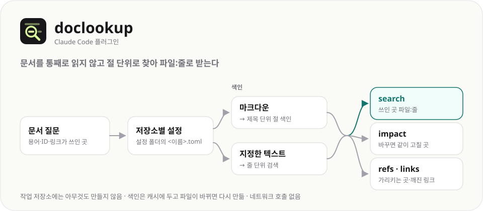

# doclookup

<p align="center">
  <picture>
    <source media="(prefers-color-scheme: dark)" srcset="docs/readme/hero-dark.svg">
    .toml)을 거쳐 마크다운은 제목 단위 절로 색인하고 지정한 텍스트는 줄 단위로 찾아, search·impact·refs·links가 파일:줄로 답하는 흐름">
  </picture>
</p>

저장소 문서를 절 단위로 색인해 두고 용어·ID·링크가 쓰인 곳과 「바꾸면 같이 고칠 곳」을 `파일:줄`로 돌려주는 개인용 Claude Code 플러그인이다. 큰 문서를 통째로 Read하거나 grep 결과를 손으로 모으는 대신 이것을 먼저 쓴다.

- 마크다운은 제목 단위 절로, 지정한 텍스트 파일(스크립트 등)은 줄 단위로 찾는다.
- 저장소마다 기기의 설정 폴더에 둔 파일 하나(`<이름>.toml`)로 범위, ID 패턴, 표기 묶음, 역할 이름을 정한다. 작업 저장소에는 아무것도 만들지 않는다.
- 런타임은 Python 3.11 이상 표준 라이브러리만 쓴다. 네트워크 호출이 없다.

## 설치

필요한 것: Claude Code, Python 3.11 이상(`uv`가 있으면 `uv`가 찾은 3.11 이상, 없으면 PATH의 `python3`이 3.11 이상이어야 한다). 실행기는 Python을 내려받지 않는다.

Claude Code에서:

```
/plugin marketplace add sch0718/claude-plugins
/plugin install doclookup@sch0718-plugins
```

설치하면 스킬 `doclookup`과 Read 안내 훅이 함께 등록된다(훅은 설정에서 켜기 전까지 아무것도 내보내지 않는다).

설치 뒤 설정이 있는 저장소에서 스킬로 `search 확정`을 한 번 불러 동작을 확인한다.

0.1.4 이하에서 올릴 때: 0.1.5부터 플러그인에 저장소 설정(`repos/*.toml`)을 넣지 않는다. 업데이트하기 전에 쓰던 설정을 기기의 설정 폴더로 옮기고 `DOCLOOKUP_CONFIG_DIR`로 가리킨다(아래 「설정을 고치는 법」).

## 설정

### 어느 설정을 쓰는가

명령을 부른 폴더의 git 체크아웃(`git rev-parse --show-toplevel`)에서 저장소 키를 구하고 그 키가 설정의 `match` 목록에 든 설정을 쓴다.

1. 원격 `origin`이 있으면 그 URL을 정규화한 값(`github.com/<조직>/<저장소>`, 사용자 정보·포트·`.git`을 뗀다)
2. 메인 체크아웃 폴더 이름(`git rev-parse --git-common-dir`의 부모 폴더 이름). 원격이 없는 저장소나 워크트리도 이 이름으로 맞춘다

### 어디서 읽는가

1. 환경 변수 `DOCLOOKUP_CONFIG_DIR`가 있으면 그 폴더의 `*.toml`
2. 플러그인에 함께 넣은 설정(`repos/*.toml`, 지금은 없다)

앞 폴더를 먼저 다 보고 다음 폴더로 넘어간다. 한 폴더 안에서는 1번 키, 2번 키 순으로, 키마다 파일 이름 순으로 처음 맞는 설정을 쓴다. `DOCLOOKUP_CONFIG_DIR`가 가리키는 폴더가 없거나 맞는 설정이 없으면 종료 코드 2로 끝나고 표준 오류에 시도한 키, 찾아본 폴더, 새 설정을 둘 경로와 최소 예시를 보인다.

`--config <파일>`을 주면 찾지 않고 그 파일을 쓴다. `--root <폴더>`를 주면 지금 폴더의 체크아웃 대신 그 폴더를 본다.

### 설정을 고치는 법(`DOCLOOKUP_CONFIG_DIR`)

설치된 플러그인 폴더는 업데이트할 때 바뀌므로 거기서 고치지 않는다. 기기의 설정 폴더(예: `~/.config/doclookup/repos`)를 만들어 `DOCLOOKUP_CONFIG_DIR`로 가리킨다.

```bash
mkdir -p ~/.config/doclookup/repos
```

`~/.claude/settings.json`의 `env`는 세션과 그 하위 프로세스에 적용되므로, 여기에 넣으면 스킬이 부르는 명령과 훅이 모두 이 값을 본다.

```json
{
  "env": {
    "DOCLOOKUP_CONFIG_DIR": "/Users/<사용자>/.config/doclookup/repos"
  }
}
```

이 폴더의 `<이름>.toml`을 만들거나 고치고 바로 써 본다. 여러 기기에서 쓰려면 설정 파일을 각 기기의 설정 폴더에 복사한다. 설정 파일이 바뀌면 다음 조회 때 색인을 다시 만든다.

### 설정 파일 형식

TOML이다. 알 수 없는 키가 있으면 오타로 보고 종료 코드 2로 끝낸다.

```toml
match = ["github.com/example-org/docs-catalog"]   # 저장소 키 목록(필수)
anchor = "github"                    # 앵커 규칙: gitlab(기본) | github

[files]
markdown = ["**/*.md"]               # 제목 단위 절로 나눈다
text = ["tools/**/*.py"]        # 줄 단위로 찾는다
exclude = [".git/**", "_workspace/**"]

[frontmatter]
columns = ["type", "status", "screen_id"]   # search --type·--where로 거를 수 있는 머리말 필드

[[ids]]                              # ID 종류마다 하나
name = "결정"
pattern = 'D-\d{3}'
defined_by = "heading"               # heading | table_first_cell | frontmatter:<필드>
scope = 'product/([^/]+)/'           # 같은 ID가 범위마다 따로 있을 때 범위를 가르는 경로 정규식(선택)
in = ["product/*/decision-log.md"]   # 정의를 찾을 파일 glob(선택)

[[aliases]]                          # 사람이 확정한 표기 묶음
canonical = "파트장"
variants = ["파트 리더", "파트리더"]

[roles]                              # 정의된 역할 이름. suspect 꼴인데 names에 없는 것을 roles 명령이 찾는다
names = ["변경관리자", "변경수행자"]
suspect = '(?:[가-힣]+ ?)?(?:승인자|검증자|책임자|승인권자)'

[variants]                           # variants 명령의 접미사 짝(선택, 아래가 기본값)
suffix_pairs = [["장", " 리더"], ["장", "리더"]]

[hint]                               # Read 안내 훅(선택)
enabled = false                      # 기본 꺼짐
min_chars = 20000                    # 이 글자 수 이상인 파일만 안내

[search]                             # search 결과 순서(선택)
priority = ["docs/규정/**", "docs/점검/01.*"]   # 앞에 적은 범위(glob 또는 폴더)의 줄을 먼저 보인다

[[extensions]]                       # 저장소 전용 단위 공급자(선택, 아래 「확장」)
name = "myext"
command = ["uv", "run", "--project", "tools", "python", "-m", "myext.doclookup_ext"]
commands = ["find", "define"]
```

- glob: `**`는 0단 이상의 폴더, `*`·`?`는 한 단 안에서 맞는다. 경로는 저장소 루트 기준이다. 숨김 폴더(`.venv` 등)도 glob에 맞으면 들어가므로 필요하면 `exclude`에 적는다. 두 glob에 다 맞는 파일은 마크다운으로 본다.
- 표기 묶음은 사람이 적은 것만 확정이다. `variants`가 보인 후보는 사람이 확인한 뒤 `[[aliases]]`에 옮겨야 묶음이 된다.
- 설정 폴더에는 설정만 넣는다. 문서 본문, 색인, 규정 인용은 넣지 않는다.

## 명령

실행기는 `skills/doclookup/bin/doclookup`이다. Claude Code에서는 스킬이 이 경로로 부른다.

```bash
skills/doclookup/bin/doclookup search 변경수행자
```

조회 명령(`gc`·`hint` 밖의 명령)은 `--root <폴더>`, `--config <파일>`을 명령 앞뒤 어디에 받아도 된다. 목록을 내는 명령은 `--limit`(기본 20)까지만 보이고 남은 수를 `… N건 더 (--limit)`로 적는다. `--width`(기본 50)는 찾은 낱말 앞뒤로 보일 글자 수다.

| 명령 | 하는 일 | 옵션 |
|---|---|---|
| `search <낱말> [낱말…]` | 낱말과 그 표기 묶음이 쓰인 곳. 띄어 쓴 여러 낱말은 어느 하나라도 들어간 줄을 찾는다(`--any`와 같은 OR). 낱말은 옵션 앞에 모아서 주고, 띄어쓰기가 든 구절은 따옴표로 묶는다. 띄어쓰기는 가리지 않는다(「정당성검증」으로 「정당성 검증」도, 그 반대도 찾는다). 첫 줄에 건수 많은 파일 5개와 「외 n개 파일 m건」을 보이고, 줄은 아래 순서로 보인다. 낱말과 다른 표기(묶음의 다른 표기, 띄어쓰기가 다른 꼴)로 걸린 줄에는 `〔표기: x〕`를 붙인다 | `--any 낱말,…`(함께 찾기), `--in <폴더 또는 glob>`, `--type <값>`(머리말 `type`), `--where 키=값`(여러 번), `--exact`(묶음을 펼치지 않음), `--files`(첫 줄에 모든 파일), `--limit`, `--width` |
| `section <파일 또는 문서 이름> <앵커 앞부분 또는 제목 일부>` | 절 하나. 여러 절이 걸리면 목록과 첫 절을 보인다 | `--all`(걸린 절 모두) |
| `id <ID>` | ID가 정의된 곳. 범위가 있는 ID는 범위별로 나눈다 | `--scope <범위>` |
| `refs <대상>` | 대상(ID, 파일, `파일#앵커`)을 가리키는 링크·ID 출현·인용 | `--scope`, `--limit`, `--width` |
| `links` | 깨진 링크·앵커 | `--limit`, `--width` |
| `impact <낱말 또는 ID 또는 파일#앵커>` | 바꾸면 같이 고칠 곳 전체. 마크다운과 텍스트 파일을 나눠 파일별 건수와 줄을 보인다 | `--scope`, `--per-file`(파일마다 보일 줄 수, 기본 5), `--width` |
| `variants <낱말>` | 묶음에 없는 비슷한 표기 후보(띄어쓰기만 다른 꼴, 접미사 짝, 같은 줄기에 다른 꼬리). 모두 「후보」로 표시한다 | `--limit` |
| `roles` | `roles.suspect` 꼴인데 `roles.names`에 없는 역할 이름. 첫 줄에 건수 많은 이름 5개와 「외 n개 이름 m건」을 보인다 | `--names`(첫 줄에 모든 이름), `--limit`, `--width` |
| `gc` | 오래되었거나 체크아웃이 없는 색인을 지운다 | `--days`(기본 30) |
| `hint` | Read 안내 훅이 부르는 명령. 사람이 부를 일은 없다 | 없음 |

`search`가 줄을 보이는 순서: 설정 `[search] priority`에 적은 범위(앞에 적은 것 먼저) → 확장이 공급한 단위(원문) → 마크다운 → 텍스트. 같은 묶음 안에서는 파일 경로·줄 순이다.

범위를 둔 ID(`[[ids]]`에 `scope`가 있는 것)는 `--scope`를 주지 않으면 범위별로 나눠 보이고 「범위 불명」 묶음을 따로 보인다. `--scope`를 주면 그 범위와 「범위 불명」만 보인다.

설정에 확장이 있으면 확장의 `commands`에 적힌 명령(예: `find`, `define`)도 같은 실행기로 부른다. 그 출력과 종료 코드는 확장이 낸 그대로다.

출력 예(시험 자료):

```
$ doclookup search 파트장
3건: docs/지침.md 2, tools/make_summary.py 1
docs/지침.md:10  변경책임자가 없으면 파트장이 맡는다.
docs/지침.md:11  파트 리더는 겸직할 수 없다. 〔표기: 파트 리더〕
tools/make_summary.py:3  "파트장",

$ doclookup refs D-001
4건: 시스템가 3, 범위 불명 1
[시스템가]
log.md:4  - [첫 결정](product/시스템가/decision-log.md#d-001첫-결정) 확인
product/시스템가/decision-log.md:9  D-001을 이어 받는다.
product/시스템나/decision-log.md:5  시스템나 첫 결정. [D-001](/product/시스템가/decision-log.md#d-001첫-결정)을 참고한다.
[범위 불명]
log.md:3  - D-001 정리
```

- SQLite에 FTS5 trigram이 없으면 모든 낱말을 LIKE로 찾고 표준 출력 첫 줄에 `알림: SQLite <버전>에 trigram이 없어 LIKE로 찾는다`를 찍는다.
- 색인을 다시 만든 직후에는 UTF-8이 아니거나 읽을 수 없어 건너뛴 파일을 표준 오류에 `건너뜀: <경로>: <까닭>`으로 알린다.

### 확장이 주는 명령 예: quotes

저장소 설정의 확장이 `quotes`를 제공하면 `doclookup quotes [md 파일…] [--all] [--json]`으로 인용을 고친 뒤 다른 사람에게 넘기기 전에 원문과 대조한다. 「」·『』 인용 문구가 원문에 있는지, 적은 조가 아닌 다른 조에 있는지, `[규정] 제N조④ 3호` 같은 조문 표기가 원문에 있는지 확인한다.

md 파일 인자는 저장소 루트(`--root`, 주지 않으면 체크아웃 최상위) 기준 상대 경로나 절대 경로다. 하위 폴더에서 불러도 그 폴더 기준이 아니다. 파일을 주지 않으면 확장이 정한 기본 문서를 본다. 출력은 확장의 텍스트나 JSON 그대로다.

`quotes`의 종료 코드: 0 문제 없음, 1 문제 있음, 2 문서·원문 없음, 또는 설정·환경·사용법 문제. 0이면 대조를 마치고 다음 작업으로 넘어간다.

- 1이면 보고된 문제(`파일:줄`)를 사용자에게 보이고, 다른 검색(grep 등)으로 넘어가지 않고, 보고된 `파일:줄`만 열어 인용·조문 표기를 고친 뒤 다시 돌린다. 출력에 대조 결과가 없고 표준 오류에 traceback만 있으면 확장이 실패한 것이므로 표준 오류를 그대로 보인다.
- 2이면 표준 오류 메시지를 그대로 보이고 그 내용으로 원인을 가려 인자 경로나 원문 위치를 확인한다. 표준 오류에 `invalid choice: 'quotes'`가 있으면 설정이나 확장에 `quotes`가 없다는 뜻이므로 설정과 확장을 확인한다. 설정 생성은 묻지 않는다. 표준 오류가 설정을 찾지 못했다는 메시지(시도한 저장소 키 등)일 때만 설정을 새로 만들지 사용자에게 묻는다.

### 종료 코드

아래 표는 기본 명령과 조회 확장 명령 `find`·`define`에 적용한다. `quotes`는 위의 종료 코드와 후속 행동을 따른다.

| 코드 | 뜻 |
|---:|---|
| 0 | 찾았다(`links`는 깨진 링크가 있을 때). `gc`는 늘 0 |
| 1 | 찾은 것이 없다 |
| 2 | 설정·환경 문제: 맞는 설정이 없음, 설정 파일 오류, Python 3.11 이상이 없음, 색인을 만들거나 열 수 없음, 확장 실패, 명령 사용법 오류 |

## 색인

- 위치: macOS `~/Library/Caches/doclookup/<체크아웃 폴더 이름>-<경로 해시 12자>/index.sqlite`, 그 밖에는 `$XDG_CACHE_HOME/doclookup/…` 또는 `~/.cache/doclookup/…`. 폴더 권한 `0700`, 파일 권한 `0600`.
- 워크트리마다 문서 판이 다르므로 체크아웃 경로마다 따로 둔다.
- 절 본문과 별도로 공백을 모두 뺀 본문을 색인한다(세 글자 이상은 FTS5 trigram, 그보다 짧으면 LIKE). 줄을 훑을 때는 낱말의 글자 사이에 공백이 있어도 없어도 맞춘다.
- 따로 색인 명령은 없다. 조회할 때마다 대상 파일 전체의 경로·수정 시각·크기, 설정 내용, 확장의 서명 파일로 서명을 만들고, 다르면 같은 폴더의 임시 파일에 새로 만들어 바꿔 끼운다.
- `gc`: 캐시 폴더 아래 `<이름>-<16진 12자>` 꼴 폴더만 보고, 색인이 기억하는 체크아웃 폴더가 없어졌거나 색인을 `--days`일 넘게 쓰지 않은 폴더를 지운다. 지운 폴더와 까닭을 한 줄씩 찍는다.

```bash
skills/doclookup/bin/doclookup gc --days 30
```

## Read 안내 훅

`hooks/hooks.json`은 PreToolUse(Read) 훅 하나를 둔다. 설정한 범위의 큰 파일을 `offset`·`limit` 없이 Read하려 하면 Claude 문맥에 아래 안내를 남긴다. Read는 막지 않는다(종료 코드 2나 `deny`를 쓰지 않고, 실패해도 0으로 끝난다).

```
이 파일은 <n>자다. 먼저 doclookup search·section·impact로 필요한 범위를 찾고 Read의 offset·limit으로 읽는다.
```

켜는 법: 그 저장소 설정에 `[hint]`를 적는다. `DOCLOOKUP_CONFIG_DIR` 폴더의 설정을 고치면 바로 적용된다.

```toml
[hint]
enabled = true
min_chars = 20000
```

- 설정은 세션의 작업 폴더가 아니라 Read할 파일이 든 체크아웃 기준으로 찾는다.
- 대상은 `[files]`의 `markdown`·`text` glob에서 `exclude`를 뺀 파일이고, UTF-8로 읽은 글자 수가 `min_chars` 이상일 때만 안내한다.
- 꺼져 있어도 훅 명령은 Read마다 실행기를 띄운다(이 기기에서 약 0.1초). 출력 형식과 확인한 출처는 [hooks/README.md](hooks/README.md)에 있다.

## 확장

저장소 전용 단위(예: 규정의 조·항·호)와 인용은 그 저장소 안의 확장이 공급한다. 확장은 하위 프로세스로 부르므로 표준 라이브러리 밖의 패키지를 써도 된다. 플러그인은 설정 `[[extensions]]`의 `command` 뒤에 하위 명령을 붙여 체크아웃 루트에서 실행하고 표준 출력의 JSON 객체를 읽는다. 확장 프로세스에는 실행기가 넣은 `PYTHONPATH`를 빼고 넘긴다.

| 하위 명령 | 표준 출력 JSON | 부르는 때 | 시간 제한 |
|---|---|---|---:|
| `signature-files` | `{"files": ["<절대 경로>", …]}` 서명에 넣을 파일 | 조회마다(가볍게 만든다) | 10초 |
| `units` | `{"units": [<단위>, …]}` | 색인을 다시 만들 때 | 60초 |
| `roots` | `{"roots": {"<저장소 상대 경로 접두어>": "<실제 폴더>", …}}` | 색인을 다시 만들 때 | 10초 |
| `cites` | `{"cites": [<인용>, …]}` | 색인을 다시 만들 때 | 60초 |
| `run <명령> <인자…>` | 출력·종료 코드를 그대로 넘긴다 | `commands`의 명령을 부를 때 | 없음 |

- 단위: `uid`(문자열), `file`(저장소 상대 경로), `line`(1 이상 정수)은 꼭 있어야 한다. `doc`(없으면 `uid`의 `#` 앞), `kind`(없으면 「단위」), `number`, `title`, `path`, `parent`(부모 `uid`), `text`는 선택이다.
- 인용: `file`, `line`, `raw`(원문 표기), `target`(대상 `uid`). `target`이 `null`이면 「대상 없음」으로 남기고 `links`에도 보인다.
- `roots`는 링크를 풀 때 먼저 적용한다. 워크트리에 없는 원문 폴더를 메인 체크아웃 폴더로 이어 「깨짐」으로 잘못 보고하지 않게 한다.
- 확장이 단위를 공급한 파일은 제목 단위 절로 다시 나누지 않고, 그 파일의 링크·머리말도 따로 뽑지 않는다.
- `run`을 뺀 하위 명령은 종료 코드가 0이 아니거나, 시간 제한을 넘거나, 표준 출력이 JSON 객체가 아니거나, 필드 형식이 틀리면 doclookup은 종료 코드 2로 끝난다. `run`은 출력·종료 코드를 그대로 넘긴다. 다만 확장을 실행하지 못하면(OSError) 2로 끝난다.

## 개발

```bash
uv run --with pytest pytest -q
```

| 경로 | 맡는 일 |
|---|---|
| `.claude-plugin/plugin.json` | 플러그인 매니페스트(마켓플레이스는 저장소 루트 `.claude-plugin/marketplace.json`의 `sch0718-plugins`) |
| `skills/doclookup/SKILL.md` | 언제·어떻게 쓰는지 |
| `skills/doclookup/bin/doclookup` | 실행기. Python 3.11 이상을 찾아 `python -P -m doclookup` |
| `hooks/hooks.json` | PreToolUse(Read) → `doclookup hint` |
| `src/doclookup/` | 색인·검색·명령 |
| `tests/` | 시험 |

## 라이선스

[PolyForm Noncommercial 1.0.0](LICENSE)으로, 비상업 목적으로만 쓸 수 있다.
배포할 때는 `LICENSE`의 Required Notice 줄을 유지한다.
OSI 오픈소스 라이선스는 아니다.
