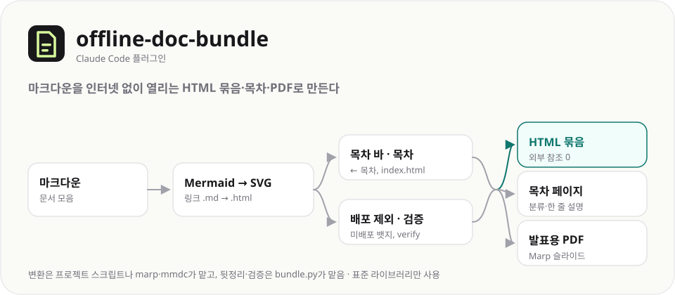

# offline-doc-bundle

<p align="center">
  <picture>
    <source media="(prefers-color-scheme: dark)" srcset="docs/readme/hero-dark.svg">
    
  </picture>
</p>

마크다운 문서를 인터넷이 없는 환경에서도 그대로 열리는 배포본(HTML 묶음, 목차, 발표용 PDF)으로 만드는 개인용 Claude Code 플러그인이에요. 회의 자료를 메일로 보내거나 폐쇄망·사내망에 반입할 때, 변환 뒤에 깨지기 쉬운 부분을 정리하고 검증해 줘요.

- Mermaid 다이어그램은 변환 단계에서 SVG로 굳혀 HTML 안에 넣는 흐름이에요(변환기는 프로젝트의 스크립트를 쓰고, 이 플러그인은 그 결과를 정리하고 검증해요). 그러면 열 때 네트워크를 쓰지 않아요.
- 문서 간 링크의 `.md`를 `.html`로 바꾸고(`#앵커`는 그대로), 모든 문서 위에 `← 목차` 바를 붙여요.
- 배포하면 안 되는 문서는 지우되, 그 문서를 가리키던 링크는 회색 글씨와 「미배포」 뱃지로 낮춰요.

## 설치

필요한 것은 Claude Code와 Python 3예요. `bundle.py`는 표준 라이브러리만 쓰고, 별도 설치할 패키지가 없어요.

마크다운→HTML·PDF 변환은 이 플러그인이 하지 않아요. 2단계(문서 전체를 Mermaid가 SVG로 박힌 HTML로)는 `--mermaid-svg` 옵션이 있는 프로젝트 변환 스크립트(예: `convert_md_to_html.py`)가 있어야 하고, 이 저장소에는 그런 스크립트가 들어 있지 않아요. 발표용 PDF는 스크립트가 없으면 아래 도구를 직접 불러요. 변환 단계는 Chrome이 필요해서 `--chrome-path`로 시스템 Chrome을 지정하는 편이 안전해요(자체 chromium이 없으면 조용히 실패해요).

- Marp CLI(`marp`): 발표용 PDF
- Mermaid CLI(`mmdc`): 다이어그램 SVG 변환

Claude Code에서:

```
/plugin marketplace add sch0718/claude-plugins
/plugin install offline-doc-bundle@sch0718-plugins
```

## 사용

Claude Code에서 「회의 자료 만들어줘」, 「문서를 PDF로 변환」, 「폐쇄망에서 열리게」처럼 말하면 스킬 `offline-doc-bundle`이 일곱 단계로 진행해요.

1. 발표용 PDF(슬라이드가 필요할 때만)
2. 마크다운 전체를 HTML로(`--mermaid-svg`로 다이어그램을 SVG로 굳혀요)
3. 링크 치환과 목차 바
4. 배포 제외 문서(있을 때만)
5. 목차 페이지
6. 검증
7. 압축(`zip`)

3~6단계는 `skills/offline-doc-bundle/scripts/bundle.py`가 맡아요. 직접 부를 수도 있어요. 인자 `root`는 변환된 HTML 폴더예요.

```bash
python3 skills/offline-doc-bundle/scripts/bundle.py link-fix _html
python3 skills/offline-doc-bundle/scripts/bundle.py exclude _html To-Be/17.초안.html To-Be/18.내부질의.html
python3 skills/offline-doc-bundle/scripts/bundle.py index _html --manifest manifest.json
python3 skills/offline-doc-bundle/scripts/bundle.py verify _html
```

| 명령 | 하는 일 | 옵션 |
|---|---|---|
| `link-fix <root>` | `href`의 `.md`를 `.html`로 바꾸고 문서마다 sticky `← 목차` 바를 넣어요. 여러 번 돌려도 중복되지 않아요 | `--no-nav`(목차 바를 넣지 않음) |
| `index <root>` | 분류된 `index.html`을 만들어요 | `--manifest <파일>`(없으면 폴더 구조로 자동 생성) |
| `exclude <root> <문서…>` | 문서를 지우고, 가리키던 링크를 회색 텍스트와 뱃지로 낮춰요. 문서 경로는 `root` 기준이에요 | `--label`(뱃지 글자, 기본 `미배포`) |
| `verify <root>` | 깨진 내부 링크, 외부 리소스 참조, `<script>` 태그, 깨진 이미지를 찾아요 | 없음 |

`verify`는 깨진 링크, 외부 리소스 참조, 깨진 이미지가 있으면 종료 코드 1로 끝나요(`<script>` 태그는 경고만 해요). 깨진 링크 0, 외부 리소스 0이어야 폐쇄망에서 열려요. 본문의 외부 링크(법령·기관 주소)는 클릭할 때만 열리므로 도메인별 건수만 알려 주고 실패로 보지 않아요. `http://www.w3.org`는 SVG 네임스페이스 선언이라 네트워크 요청이 아니에요.

### 목차 manifest

`index --manifest`에 넘기는 JSON이에요. 없으면 폴더 구조로 목차를 만들지만, 받는 사람이 처음 보는 화면이라 분류와 한 줄 설명을 직접 쓰는 편이 나아요. 분류는 폴더가 아니라 읽는 사람의 목적(오늘 회의 자료, 판정 근거, 배경 분석 등)으로 나눠요.

```json
{
  "title": "프로젝트 문서 모음",
  "subtitle": "2026-09-16 팀 회의 · 예시 팀",
  "lead": "발표용 슬라이드 PDF는 <a href=\"발표자료.pdf\">여기</a>에 있습니다.",
  "notice": "<strong>사외 반출 금지</strong> — 사내 규정 원문이 포함되어 있습니다.",
  "sections": [
    {
      "name": "오늘 회의 자료",
      "desc": "회의에서 함께 보는 문서입니다.",
      "items": [{ "path": "To-Be/19.발표자료.html", "note": "발표자료 본문", "badge": "회의 자료" }]
    }
  ]
}
```

| 필드 | 설명 |
|---|---|
| `title`, `subtitle` | 머리말 |
| `lead`, `notice` | 머리말 아래 한 줄, 노란 경고 박스(HTML 허용) |
| `sections[].name`, `desc` | 분류 이름과 한 줄 설명 |
| `items[].path` | `root` 기준 상대 경로. 파일이 없으면 건너뛰고 알려 줘요 |
| `items[].title` | 생략하면 문서의 첫 `<h1>` |
| `items[].note`, `badge` | 여는 이유를 쓰는 카드 설명, 핵심 문서에만 붙이는 뱃지 |

자세한 형식은 [manifest.md](skills/offline-doc-bundle/references/manifest.md), 슬라이드 작성과 검증 규칙은 [marp.md](skills/offline-doc-bundle/references/marp.md)에 있어요.

### 보내기 전에

- 마크다운을 고쳤으면 HTML만 손보지 말고 다시 변환한 뒤 `verify`를 돌려요.
- 슬라이드 구분자(`---`) 하나가 빠지면 두 장이 합쳐져 아래쪽이 조용히 잘려요. PDF 페이지 수와 `---` 개수를 맞춰 봐요.
- 사내 규정 원문 같은 민감 자료가 섞였으면 수신자 범위를 확인하고 manifest의 `notice`에 반출 금지 문구를 넣어요.
- 메일에는 발표용 PDF와 HTML 묶음 zip 두 개만 붙이고, 받는 사람이 zip을 풀어 `index.html`을 열도록 안내해요.

## 개발

자동 시험은 없어요. `bundle.py`를 고쳤으면 샘플 HTML 폴더에 네 명령을 차례로 돌려 확인해요.

| 경로 | 맡는 일 |
|---|---|
| `.claude-plugin/plugin.json` | 플러그인 매니페스트(마켓플레이스는 저장소 루트 `.claude-plugin/marketplace.json`의 `sch0718-plugins`) |
| `skills/offline-doc-bundle/SKILL.md` | 언제·어떻게 쓰는지 |
| `skills/offline-doc-bundle/scripts/bundle.py` | link-fix·index·exclude·verify |
| `skills/offline-doc-bundle/references/` | manifest 형식, Marp 슬라이드 규칙 |

## 라이선스

[PolyForm Noncommercial 1.0.0](LICENSE)입니다. 소스를 공개하지만 오픈소스 라이선스는 아닙니다.

- 개인 사용, 학습·연구, 비영리 단체·교육·공공 기관의 사용은 자유롭게 할 수 있습니다. 고쳐 쓰는 것도 됩니다.
- 상업적 목적의 사용은 할 수 없습니다. 회사 업무에 쓰는 것도 여기에 들어갑니다. 상업적으로 쓰려면 따로 문의해 주세요.
- 복사본이나 고친 판을 다른 사람에게 줄 때는 라이선스 전문(또는 URL)과 아래 줄을 함께 넘겨 출처를 밝혀야 합니다.

  ```
  Required Notice: Copyright (c) 2026 신춘호 (sch0718) (https://github.com/sch0718/claude-plugins/tree/main/plugins/offline-doc-bundle)
  ```
