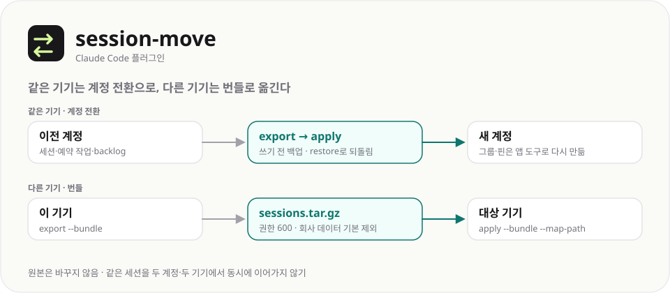

# session-move

<p align="center">
  <picture>
    <source media="(prefers-color-scheme: dark)" srcset="docs/readme/hero-dark.svg">
    
  </picture>
</p>

Claude 데스크톱 앱 Code 탭의 세션을 같은 기기의 다른 계정으로, 또는 번들로 묶어 다른 기기로 옮깁니다. 기본은 같은 기기 계정 전환입니다.

## 설치

```
/plugin marketplace add sch0718/claude-plugins
/plugin install session-move@sch0718-plugins
```

macOS, Python 3.11 이상이 필요합니다. 명령은 `plugins/session-move/bin/session-move`입니다(아래 `SM`). 스킬 `/session-move`가 순서를 안내합니다.

## 같은 기기 (계정 전환)

| 옮기는 것 | 방법 |
|---|---|
| 세션, 하위 세션 연결, 워크트리·브랜치 정보 | 같은 ID로 복사. 계정에 묶인 값(Remote Control, 커넥터 설정 등)은 지움 |
| 예약 작업, backlog | 대상에 없는 것만 추가(backlog는 같은 ID면 더 새로운 쪽) |
| 그룹·섹션·핀 | 새 계정 세션에서 스킬이 앱 도구로 다시 만듦 |
| 프리셋 | 목록만 보여 줌(앱에서 직접 만듦) |
| 대화 기록, CLAUDE.md, 메모리 | 같은 기기라 옮길 필요 없음 |

```
SM export --source <이전 계정ID>/<조직ID>
SM apply --manifest <출력된 경로> --to <새 계정ID>/<조직ID> --dry-run
```

앱을 ⌘Q로 끄고 macOS 터미널 앱에서:

```
SM apply --manifest <경로> --to <대상> --only sessions --only-session <세션ID>
SM apply --manifest <경로> --to <대상>
```

계정을 오가며(A→B→A) 옮기면, 같은 ID의 세션은 원본이 더 최근일 때만 갱신하고 보관 상태도 따라갑니다.

## 다른 기기

```
SM export --bundle ~/Desktop/sessions.tar.gz
```

| 항목 | 내용 |
|---|---|
| `sessions`·`transcripts` | 세션 파일과 대화 기록 |
| `schedules`·`backlog`·`sidebar`·`presets` | 같은 기기와 같음. 예약 작업은 꺼진 상태로 들어감 |
| `instructions` | `~/.claude/CLAUDE.md`, `settings.json`, `commands/` |
| `skills` | `~/.claude/skills`, `~/.agents/skills`(링크 유지) |
| `plugins` | 마켓플레이스·설치 목록(설치 명령을 안내) |
| `mcp` | MCP 서버 정의(env·헤더 값은 비움) |
| `memory` | 프로젝트 메모리, agentmemory 데이터(서버를 멈춘 뒤) |
| `repos` | 저장소 원격 주소·브랜치(`--clone`이면 대상에서 받음) |

`--only`·`--skip`으로 항목을 고릅니다. 대상 기기에 설정 파일이 이미 있으면 덮어쓰지 않고 `<이름>.from-<원본 기기>`로 옆에 둡니다.

대상 기기에서(앱을 끄고 터미널 앱에서):

```
SM inspect --bundle sessions.tar.gz
SM apply --bundle sessions.tar.gz --map-path /Users/old=/Users/new --dry-run
SM apply --bundle sessions.tar.gz --map-path /Users/old=/Users/new [--clone]
```

### 회사 데이터

다른 기기 번들은 회사 데이터를 기본으로 뺍니다. 회사 판정 설정을 먼저 만들어야 합니다(없으면 내보내기가 멈춥니다).

```toml
# ~/.session-move/config.toml
orgs = ["example-org"]
repos = ["example-repo"]
path_prefixes = ["/path/to/company/work"]
```

`~/.config/claude-plugins/denylist.txt`(한 줄에 낱말 하나)가 있으면 그 낱말도 함께 봅니다. 회사 저장소 세션, 내용에 회사 낱말이 나오는 세션, 그 세션의 하위 세션과 backlog, 회사 낱말이 든 스킬·명령·예약 작업·MCP 정의, agentmemory는 빠지고 개수만 보고됩니다. 전역 `CLAUDE.md`는 담고 경고합니다. 모두 담으려면 `--include-company`를 줍니다.

번들 파일 권한은 600이고 암호화하지 않습니다. 암호화가 필요하면 macOS 디스크 유틸리티의 암호화 디스크 이미지에 넣어 옮기고, 옮긴 뒤 지우세요.

## 되돌리기

`apply`는 쓰기 전에 바꿀 모든 경로를 `~/.session-move/backups/`에 담고 출력에 `백업:` 경로를 남깁니다. 앱을 끄고 `SM restore <백업>`으로 되돌립니다(새로 생긴 파일도 지움). 적용한 뒤에 바뀐 파일이 있으면 목록을 보여 주고 멈추며, 그래도 되돌리려면 `--force`를 붙입니다. 되돌리기 직전 상태도 따로 백업합니다. 원본은 바꾸지 않습니다.

## 옮기지 않는 것

Cowork 세션, 커넥터 인증, Remote Control, PR Auto-fix 감시, claude.ai의 대화·프로젝트. 같은 세션을 두 계정·두 기기에서 동시에 이어가지 마세요.

## 시험

```
cd plugins/session-move && python3 -m unittest discover -s tests
```

## 라이선스

[PolyForm Noncommercial 1.0.0](LICENSE)입니다. 소스를 공개하지만 오픈소스 라이선스는 아닙니다.

- 개인 사용, 학습·연구, 비영리 단체·교육·공공 기관의 사용은 자유롭게 할 수 있습니다. 고쳐 쓰는 것도 됩니다.
- 상업적 목적의 사용은 할 수 없습니다. 회사 업무에 쓰는 것도 여기에 들어갑니다. 상업적으로 쓰려면 따로 문의해 주세요.
- 복사본이나 고친 판을 다른 사람에게 줄 때는 라이선스 전문(또는 URL)과 아래 줄을 함께 넘겨 출처를 밝혀야 합니다.

  ```
  Required Notice: Copyright (c) 2026 신춘호 (sch0718) (https://github.com/sch0718/claude-plugins/tree/main/plugins/session-move)
  ```
